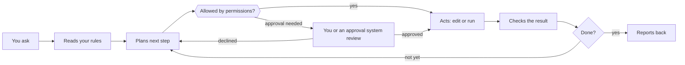

# Start here: how the pieces think

An AI agent can use tools to work on your files. Some agents also retain instructions or memory across sessions. This playbook gives that work a shared record: notes hold approved context, rules describe the job, and you review consequential changes before they happen.

## The core idea

Give the agent a short working brief: who you are, what matters now, how you want work handled, and the current inbox. Keep it in files you can inspect. A fresh session can then read the same approved context, even when you change tools.

The vault holds that brief. `AGENTS.md` describes the rules, and the inbox holds new work. The agent proposes changes in a reviewable file. You approve the exact plan before an interactive session applies it.

## Model, chat app, agent

These three get blurred, and the difference explains most of the design.

- **A model** generates responses from supplied context. Agent software provides file access, tools and mechanisms for loading saved information.
- **A chat app** wraps models in a conversation interface and may offer saved history, memory and connected tools.
- **An agent** wraps a model in a loop with tools. It can read and write files, run commands and check its own results, step after step, until the task is done. Claude Code and Codex are agents.

A permission prompt does not appear before every edit. Its behavior depends on the tool and permission mode. The checkbox approval workflow is a separate convention in this playbook. Scheduled tasks need narrow tool permissions as well as clear instructions.

## What carries across sessions

A model generates a response from the context supplied for that run, within a limited context window. Agent software can load saved conversations, instruction files and memory notes into that context. Information carried across sessions depends on the product and its settings.

Built-in memory can be useful and may itself use readable files. For example, Claude Code documents auto memory that carries corrections and preferences across sessions. The vault adds a common record of approved context that multiple tools can use, with history you manage. Keep notes short and tell each job which ones to read.

## The parts in plain terms

| Part | What it is | Why it's here | Everyday comparison |
| --- | --- | --- | --- |
| Markdown | Plain text with a few symbols: `#` for a heading, `-` for a list item | You, any app and every AI can read it. No lock-in | A typed memo instead of a Word file |
| Obsidian | A free app that turns a folder of Markdown files into a linked notebook | Phone app, search, links and views over files agents can edit directly | A binder with tabs and an index |
| Properties | Labels at the top of a note, such as `type: task` and `status: active` | Views and agents sort notes by them reliably | Colored tabs on a folder |
| Wikilinks | `[[Note name]]` links between notes | Tie tasks to projects and people to meetings | Cross-references |
| Bases | Obsidian's table views over notes and their properties | A task list and backlog with no extra app | A filtered spreadsheet of the binder |
| Obsidian Sync | A paid service that keeps the vault the same on every device | Capture from anywhere | Copies kept in step |
| Git | A tool that records snapshots you commit | Restore a recorded version of a tracked file | Track changes for a whole folder |
| GitHub | A website that stores your Git history privately | An off-site copy of pushed commits that configured cloud jobs can reach | An off-site archive with a front desk |
| `AGENTS.md` | An instruction file supported agents can load | Share conventions and verify which files loaded | The binder's first page |
| Skills | Packaged instructions for a specific job | Agents learn Obsidian's formats without you explaining | A training manual |
| Scheduled task | A saved prompt that runs on a timer | Work happens without you asking | A standing order |
| Connectors (MCP) | Standard plug-ins that link an agent to email, calendar or drive | The agent can see your day | Read access to your calendar for the temp |
| Permissions | Controls on tools, file access and approval requests | Limit access and check what requires approval | Signing off on expenses |
| Terminal | A text window for typing commands to your computer | A few setup steps exist only as commands | The back office |

## Why it's built this way

Every rule in this playbook traces to one of three facts about today's AI.

1. **Saved context needs review.** Put approved priorities and corrections in shared files so you can inspect them and load them deliberately.
2. **It is sometimes confidently wrong.** Review proposed changes, check the files, and keep tested recovery points in Git.
3. **Outside content can try to steer it.** Treat email and web content as data, restrict tools, start connectors read-only, and check changes before applying them.

The [design principles](03-architecture.md#design-principles) are these three facts turned into rules.

## What surprises newcomers

- **A correction needs a durable record.** Some tools save memory automatically. For this workflow, approve important corrections into the shared notes and verify their use in a fresh session.
- **More instructions aren't better.** Long rules slow every run and bury the lines that matter. Short and specific wins.
- **It can sound certain and be wrong.** Ask where a claim came from, open the file yourself, and treat its summary of its own work as a claim to check.
- **Nothing happens between runs.** It acts only while a session or scheduled task is running. Nothing watches your notes in the background.
- **Runs consume usage.** Agent sessions and schedules draw on the limits or credits of the product and plan you use. Review the usage dashboard before increasing frequency.
- **Vague requests get surprises.** "Clean up my notes" invites anything. "Propose a plan for the five oldest inbox items" gets something you can approve.

---

[Contents](../README.md#contents) | [Next: Your first hour: practice before you build](02-first-hour.md)
