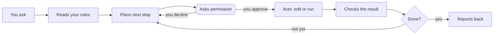

# Start here: how the pieces think

An AI agent is a capable assistant that starts every session with no memory of you. Everything in this playbook exists to fix that one problem safely: notes hold the memory, a rules file holds the job description, and approvals keep you in charge.

## The core idea

Picture a sharp temp who arrives every morning with total amnesia. They read fast, write well and can use the office's tools, but remember nothing from yesterday. You wouldn't fire them. You'd leave a binder on the desk: who you are, what you're working on, how you like things done, and today's inbox.

That binder is the vault. `AGENTS.md` is its first page, read before anything else. The inbox is where new work arrives. And because the temp is sometimes confidently wrong, they leave proposals in a tray for you to initial instead of acting alone on anything important.

## Model, chat app, agent

These three get blurred, and the difference explains most of the design.

- **A model** is the AI itself, such as Claude or GPT. Text goes in, text comes out. On its own it can't open files or remember anything.
- **A chat app** wraps a model in a conversation window. It may remember some things about you, but only inside that one vendor's product.
- **An agent** wraps a model in a loop with tools. It can read and write files, run commands and check its own results, step after step, until the task is done. Claude Code and Codex are agents.

A scheduled task runs the same loop with nobody at the keyboard. That's why scheduled prompts are written tighter and their permissions are narrower.

## Why it forgets, and why files fix it

A model only knows what is in front of it during the current session, called the context window. The window holds a limited amount of text, measured in tokens. A token is roughly three quarters of an English word. When the session ends, the window is cleared.

Built-in memory features help a little, but they belong to one app and are hard to inspect or correct. Files are different: you can read, edit, search and back them up, and any agent can use them. So every durable fact lives in the vault. Notes stay short because everything the agent reads takes room in the window and draws on your usage allowance.

## The parts in plain terms

| Part | What it is | Why it's here | Everyday comparison |
| --- | --- | --- | --- |
| Markdown | Plain text with a few symbols: `#` for a heading, `-` for a list item | You, any app and every AI can read it. No lock-in | A typed memo instead of a Word file |
| Obsidian | A free app that turns a folder of Markdown files into a linked notebook | Phone app, search, links and views over files agents can edit directly | A binder with tabs and an index |
| Properties | Labels at the top of a note, such as `type: task` and `status: active` | Views and agents sort notes by them reliably | Colored tabs on a folder |
| Wikilinks | `[[Note name]]` links between notes | Tie tasks to projects and people to meetings | Cross-references |
| Bases | Obsidian's table views over notes and their properties | A task list and backlog with no extra app | A filtered spreadsheet of the binder |
| Obsidian Sync | A paid service that keeps the vault the same on every device | Capture from anywhere | Copies kept in step |
| Git | A tool that records every saved version of every file | Undo for anything an agent does | Track changes for a whole folder |
| GitHub | A website that stores your Git history privately | Off-site backup, and the only copy cloud agents can reach | An off-site archive with a front desk |
| `AGENTS.md` | A plain-text instruction file agents read first | Write your rules once for every agent | The binder's first page |
| Skills | Packaged instructions for a specific job | Agents learn Obsidian's formats without you explaining | A training manual |
| Scheduled task | A saved prompt that runs on a timer | Work happens without you asking | A standing order |
| Connectors (MCP) | Standard plug-ins that link an agent to email, calendar or drive | The agent can see your day | Read access to your calendar for the temp |
| Permissions | The agent asks before running commands or changing files | You see every action until you trust it | Signing off on expenses |
| Terminal | A text window for typing commands to your computer | A few setup steps exist only as commands | The back office |

## Why it's built this way

Every rule in this playbook traces to one of three facts about today's AI.

1. **It forgets.** So memory lives in files you own, and one rules file serves every agent.
2. **It is sometimes confidently wrong.** So it proposes and you approve, its claims get checked against the files, and Git keeps an undo for everything.
3. **It acts on whatever text it reads, including text in an email or web page.** So outside content is treated as data, approvals stay on, connectors start read-only, and agents write only in their own folder.

The [design principles](03-architecture.md#design-principles) are these three facts turned into rules.

## What surprises newcomers

- **It doesn't learn from conversations.** A correction disappears when the session ends unless it gets written into a note.
- **More instructions aren't better.** Long rules slow every run and bury the lines that matter. Short and specific wins.
- **It can sound certain and be wrong.** Ask where a claim came from, open the file yourself, and treat its summary of its own work as a claim to check.
- **Nothing happens between runs.** It acts only while a session or scheduled task is running. Nothing watches your notes in the background.
- **Every run costs allowance.** Your plan's usage pays for chat, agent sessions and scheduled jobs alike. An hourly job can eat a day's budget.
- **Vague requests get surprises.** "Clean up my notes" invites anything. "Propose a plan for the five oldest inbox items" gets something you can approve.

---

[Contents](../README.md#contents) | [Next: Your first hour: practice before you build](02-first-hour.md)
