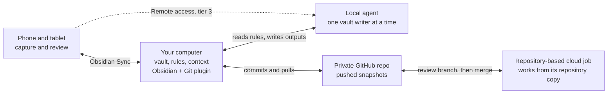

# Architecture

Five parts organize the work: a folder of notes, device sync, committed history, an agent with written rules, and a scheduler. Everything else is optional.

| Part | Job | Reference build | Tier |
| --- | --- | --- | --- |
| Obsidian vault | Shared memory and workspace in Markdown files | One vault on the desktop | 1 |
| Obsidian Sync | Syncs the vault across devices, with end-to-end encryption | Sync Standard | 1 |
| Rules files | Describe folders, schema, approval workflow and permitted changes | Workspace and vault AGENTS.md files, with CLAUDE.md imports | 1 |
| Agent | Reads relevant notes and performs authorized work | Claude Code and Codex | 1 |
| Obsidian skills | Instructions for Obsidian formats and tools | kepano/obsidian-skills | 1 |
| Private GitHub repo and desktop Git plugin | Committed snapshots, pushed off-site; a repository copy for cloud jobs | Commit-and-sync interval configured at 10 minutes | 2 |
| Scheduler | Starts triage, briefs and reviews | Local jobs first | 2 |
| Remote access | Starts or steers sessions on a connected computer | Separate session access and repair access | 3 |
| Connectors | Read selected calendar, email or drive data | Granted per job, read-only first | 3 |

In this design, local jobs use the vault on your computer and repository-based cloud jobs use its GitHub copy. Obsidian Sync does not give those cloud jobs a filesystem connection to the vault. A computer running Obsidian and the Git plugin bridges the copies after reviewed cloud changes reach its tracked branch.

The arrows show the paths used by this build. Other products can support additional cloud and remote connections, so check the execution location and file access of the job you create.

## Design principles

1. **Files are the shared record.** Keep approved context in the vault. Built-in memory can complement it. Check which notes each agent loads when you change tools.
2. **Share rules and verify loading.** Codex discovers guidance from its project root down to the working folder. A parent workspace file may sit outside that chain once the vault is its own repo, so the vault rules explicitly ask the agent to read it. Claude Code can load AGENTS.md or import it through CLAUDE.md. Confirm the loaded files in each tool.
3. **Propose, approve, apply.** Existing-note changes start as a checkbox plan. Name the exact plan when asking an interactive session to apply your selected changes. Written rules do not authenticate who ticked a box or replace tool permissions.
4. **Give each run a unique output.** Use YYYY-MM-DD-HHMMSS-<run-id>-<slug>.md, check that the path does not exist, and never replace an earlier output. Run one writer at a time in the vault, including updates to agents/log.md. Separate files reduce conflicts but do not eliminate them.
5. **Check the file, not the message.** Inspect outputs and changes before accepting a success report. Claude cloud task status describes how the session ended, not whether every requested result exists.
6. **One desktop handles Git sync.** Phones and tablets use Obsidian Sync. Pause automation while resolving a conflict, check both sides, and resume only after the files and history agree.
7. **Keep tested recovery points.** Approved deletes go to .trash/. Git can restore committed content, and GitHub holds pushed commits. Neither records every edit between commits. Test restoring a sample note before unattended work.

---

[Previous: Your first hour: practice before you build](02-first-hour.md) | [Contents](../README.md#contents) | [Next: Decisions before you start](04-decisions.md)
