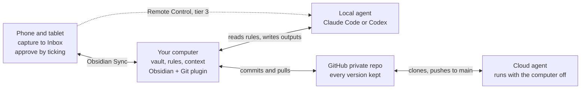

# Architecture

Five parts do all the work: a folder of notes, a way to get that folder onto every device, a history of every change, an agent with written rules, and a scheduler. Everything else is optional.

| Part | Job | Reference build | Tier |
| --- | --- | --- | --- |
| Obsidian vault | Memory and workspace. Plain Markdown files any agent can read and write | One vault in the shared AI folder on the desktop | 1 |
| Obsidian Sync | Puts the vault on phone and tablet, end-to-end encrypted | Sync Standard | 1 |
| Rules file (`AGENTS.md`) | The operating manual every agent reads before acting: folders, note schema, what it may change | One at the workspace root, one in the vault; `CLAUDE.md` imports it | 1 |
| Agent | Does the work in the vault under the rules | Claude Code and Codex on the same files | 1 |
| Obsidian skills | Teach agents Obsidian formats: wikilinks, properties, Bases, Canvas, the Obsidian CLI | kepano/obsidian-skills | 1 |
| GitHub private repo + Obsidian Git plugin | Full history and undo. Also the only door cloud agents can use | Desktop plugin set to commit every 10 minutes | 2 |
| Scheduler | Runs triage, briefs and reviews without you asking | Scheduled jobs on the desktop | 2 |
| Remote access | Start and steer agent sessions from your phone | A phone app connected to a desktop agent session, plus a separate repair path | 3 |
| Connectors | Email, calendar, drive, task tools | Added per job, read-only first | 3 |

One constraint shapes every later choice: **cloud agents can see GitHub, not Obsidian Sync.** A computer running Obsidian bridges the two by committing and pulling. When no such computer is on, anything a cloud agent writes waits on GitHub until one is. That is why tier 3 adds an always-on machine, and why tier 2 runs its scheduled jobs on your own computer.

Phone and cloud never touch: Sync carries notes to your computer, the Git plugin carries them to GitHub, and cloud agents only ever see GitHub.

## Design principles

1. **Files are the source of truth.** Built-in agent memory belongs to one agent and one vendor. Durable knowledge goes in the vault, where you and every agent can read and correct it. Switching vendors later costs nothing.
2. **One rules file for every agent.** Write conventions once in `AGENTS.md`. Codex reads it natively. Claude Code reads it when no `CLAUDE.md` exists, and a one-line `CLAUDE.md` containing `@AGENTS.md` guarantees it.
3. **Propose, approve, apply.** Anything that moves, renames or removes notes starts as a checkbox plan. You tick what you approve, on any device, and only ticked lines are applied.
4. **Agents write in their own lane.** Job output goes to new dated files under `agents/outputs/`, plus one line per job in `agents/log.md`. Nothing is overwritten. New files never collide with your own edits, so Sync and git stay conflict-free.
5. **Check the file, not the message.** An agent saying "done" proves nothing. Claude's cloud scheduler marks a run Succeeded when the session ends without error, whether or not the work got done. In the reference build, a model once claimed a file held content it did not.
6. **One committer.** Only one desktop runs the Git plugin. Phones and tablets use Sync. Two devices auto-committing to one repo produces merge conflicts, and conflict markers then sync everywhere.
7. **Recoverable by default.** Approved deletes go to `.trash/`. Git keeps every version. The agent never hard-deletes.

---

[Previous: Your first hour: practice before you build](02-first-hour.md) | [Contents](../README.md#contents) | [Next: Decisions before you start](04-decisions.md)
